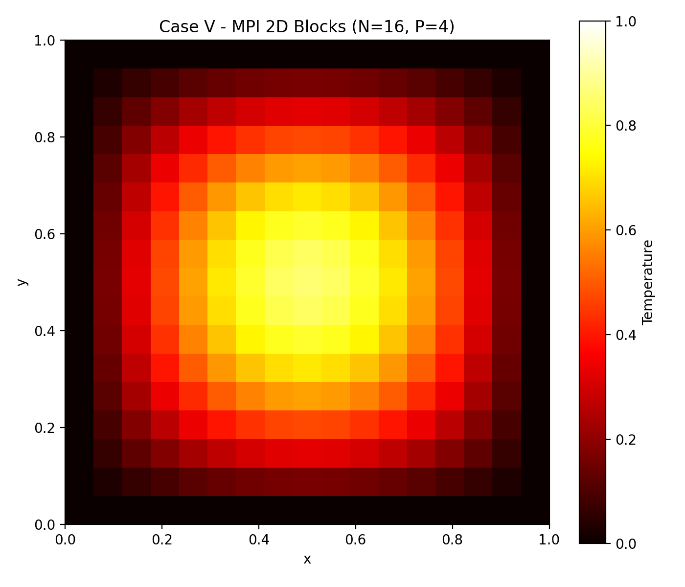

# Part 3 – MPI 2D Block Decomposition

## Objective

Implement a parallel 2D heat diffusion solver using MPI with a two-dimensional block decomposition and compare its correctness and performance with the serial and 1D strip implementations.

## Implementation

The solver uses:

- MPI_Dims_create to determine the process grid dimensions.
- MPI_Cart_create to create a non-periodic Cartesian topology.
- MPI_Cart_shift to identify neighboring processes.
- Balanced distribution of interior grid points.
- Ghost cells on all four sides of each local block.
- MPI_Type_vector for non-contiguous column communication.
- MPI_Sendrecv for halo exchanges.
- MPI_Gatherv for global grid reconstruction.
- MPI_Wtime for computation and communication measurements.

Corner ghost cells are not exchanged because the five-point stencil does not require diagonal neighbors.

### Why corners are not needed

The five-point update of node (i, j) reads only (i, j) and its four edge
neighbours (i±1, j) and (i, j±1). For a node in the corner of a block, those
neighbours lie in the left/right ghost column or the bottom/top ghost row, never
in a corner ghost cell. A stencil that reads diagonal neighbours would need the
corners, for example the nine-point (compact) Laplacian, which uses
(i±1, j±1). With it, the corner values would have to be exchanged too: either
four extra diagonal messages, or by doing the row exchange first and then sending
columns that include the freshly received ghost rows.

## Compilation

```bash
cd part3
make
```

The generated executable is `heat_blocks`.

## Execution

### Local execution

```bash
mpirun -np 4 ./heat_blocks --decomp blocks --case 2 --N 16 --r 0.2 --steps 10
```

### Distributed execution over Tailscale

```bash
mpirun --hostfile hosts_3vm_P4 -np 4 \
  --map-by slot \
  --mca oob_tcp_if_include tailscale0 \
  --mca btl_tcp_if_include tailscale0 \
  --mca btl tcp,self \
  ./heat_blocks --decomp blocks --case 2 \
  --N 16 --r 0.2 --steps 10 \
  --out results/case2.bin
```

Update the hostfiles according to the available machines and their Tailscale addresses.

The executable must be compiled and available at the same path on every participating VM.

## Simulation cases

- Case 1: Four hot boundaries.
- Case 2: Hot top and bottom boundaries and cold lateral boundaries, with hot corners.
- Case V: Analytical verification using a sinusoidal initial temperature and zero boundary temperatures.

## Correctness verification

The automated correctness tests cover:

- Grid sizes N = 8, 9, 10 and 16.
- Process counts P = 1, 2, 3, 4, 6 and 8.
- All three simulation cases.

Result: 72/72 tests passed.

Distributed execution was also verified using multiple VMs. The results were identical to the serial reference in the tested configurations.

To run the automated tests:

```bash
bash tests/check_correctness.sh
```

Compile the Part 1 reference solver before running the tests. Local tests with more processes than available CPU slots use oversubscription and are not performance benchmarks.

## Simulation results

### Case 1


### Case 2


### Case V



These demonstrations use N = 16, P = 4, r = 0.2 and 10 time steps.

## Prediction: strips or blocks? (Task 8.2)

Computed by `analysis/predict_strips_vs_blocks.py` from the Part 0 network
measurements (heat-2 ↔ heat-1: ts = 3.511 ms, 1.746 MB/s) and the Part 4
per-VM compute cost. Output: `results/predictions_strips_vs_blocks.csv`.

- **Simple model** (one interior process, every message on the cross-VM link):
  strips Tcomm = 2(ts + (N+1)tw), blocks Tcomm = 4(ts + (N/√P)tw).
- **Refined model** (slot placement, real block sizes and physical edges,
  same-VM vs cross-VM links, per-VM compute speed; slowest rank per step).
  P = 4 is heat-2 ×2 + heat-1 ×2; P = 8 is heat-2 ×4 + heat-1 ×4.

| P | N | Simple: strips comm (ms) | Simple: blocks comm (ms) | Refined: strips step (ms) | Refined: blocks step (ms) | Refined predicts |
| --- | --- | --- | --- | --- | --- | --- |
| 4 | 512 | 11.7 | 18.7 | 11.9 | 9.5 | blocks |
| 4 | 2048 | 25.8 | 32.8 | 28.7 | 19.3 | blocks |
| 4 | 8192 | 82.1 | 89.1 | 132.7 | 95.2 | blocks |
| 8 | 512 | 11.7 | 17.4 | 11.8 | 9.5 | blocks |
| 8 | 2048 | 25.8 | 27.3 | 27.2 | 17.9 | blocks |
| 8 | 8192 | 82.1 | 67.1 | 107.4 | 69.9 | blocks |

The two models disagree, and the reason is the network. With ts ≈ 3.5 ms,
latency dominates. The simple model counts four messages per step for blocks
against two for strips, so it favours strips except at P = 8, N = 8192, where
the shorter block edges finally win. The refined model accounts for placement.
In the 2×2 grid only the up/down exchange crosses between the VMs, and it
carries N/2 values. The left/right exchange stays inside a VM. With strips,
the one cross-VM message carries a full row of N+1 values. Blocks send half as
much data over the slow link, so the refined model favours blocks everywhere.

## Performance comparison

The performance experiments compare the 1D strip and 2D block implementations.

Experimental configuration:

- Two Ubuntu VMs connected through Tailscale: heat-2 and heat-3, two ranks each (slot placement).
- Four MPI processes.
- Case 2.
- r = 0.24.
- 10 time steps.
- Three repetitions per method and grid size.

### Median execution times

| Grid size | Processes | 1D Strips (s) | 2D Blocks (s) | Strips/Blocks ratio |
| --- | --- | --- | --- | --- |
| 512 | 4 | 3.3820 | 2.0395 | 1.66 |
| 2048 | 4 | 6.9643 | 4.4194 | 1.58 |
| 8192 | 4 | Not completed | Not completed | N/A |

The 2D block decomposition achieved lower median execution times for both completed grid sizes.

Communication dominated the execution time because the processes communicated across the Tailscale network.

The measured ordering (blocks faster) agrees with the refined model and not with
the simple one. The measured medians are 16–32 times larger than the refined model predicts
for this heat-2 + heat-3 placement (`part4/results/consolidated/model_vs_measured.csv`):
the model assumes the Part 0 ping-pong figures hold for every message, while the
runs saw Wi-Fi jitter, TCP retransmissions and synchronisation waits between
ranks. Individual repetitions varied by up to a factor of 4.6.

## Benchmark execution

The remaining measurements use the resumable runner from Part 4. It skips
finished repetitions, keeps failed attempts as `*.failed.log`, and re-checks the
cluster after repeated failures:

```bash
cd ~/part3
bash benchmarks/finish_part3.sh               # P=4 on heat-2 + heat-1, N = 512, 2048, 8192
bash benchmarks/finish_part3.sh p8 HOSTFILE   # P=8, only with 8 real vCPUs
```

Results go to `results/campaign_P4_ali/` and `results/campaign_P8/`. The
earlier scripts (`compare_2vm.sh`, `compare_large_ali.sh`) are kept because they
produced the logs in `final_benchmarks/` and the failed N=8192 attempts.

The Part 2 strip solver must also be compiled and available on the participating machines. The benchmark scripts assume the project directories are located under the MPI user's home directory.

The raw logs of the 12 successful benchmark runs are available in `results/final_benchmarks/`.

## Experimental limitations

The first N = 8192 attempts (`results/benchmark_full_*`) all produced empty
logs. The cause was found in the strips solver, not the network. `heat_strips`
always gathered the full grid to rank 0, even without `--out`, and printed its
summary only afterwards. At N = 8192, P = 4, the two remote ranks had to send
about 268 MB over a link measured at about 1.75 MB/s. That takes about 150 s,
longer than the 120 s timeout, so each run was killed after the time steps but
before printing. The old script stopped at the first failure, so blocks
N = 8192 was never started. `heat_strips` now gathers only for `--out` or
Case V, as `heat_blocks` already did. The timed loop is unchanged, so earlier
strips timings remain valid. The failed logs are kept as evidence.

Experimental performance measurements with P = 8 were not performed because the three available VMs provided only six virtual CPUs in total.

Oversubscription was avoided during performance experiments.

The theoretical analysis includes the missing configurations, but no experimental results are claimed for them.

## Project structure

```text
part3/
├── src/
│   └── blocks.cpp
├── analysis/
│   └── predict_strips_vs_blocks.py
├── tests/
├── benchmarks/
├── results/
│   ├── final_benchmarks/
│   ├── demo_blocks_case1.png
│   ├── demo_blocks_case2.png
│   ├── demo_blocks_caseV.png
│   ├── demo_verification.txt
│   └── step16_correctness_log.txt
├── Makefile
├── .gitignore
├── README.md
└── MPI hostfiles
```

## Conclusion

The MPI 2D block implementation successfully reproduces the serial reference solution for the tested configurations.

The completed performance experiments demonstrate the potential advantage of 2D block decomposition over 1D strips, while highlighting the impact of network latency and connectivity on distributed performance.
