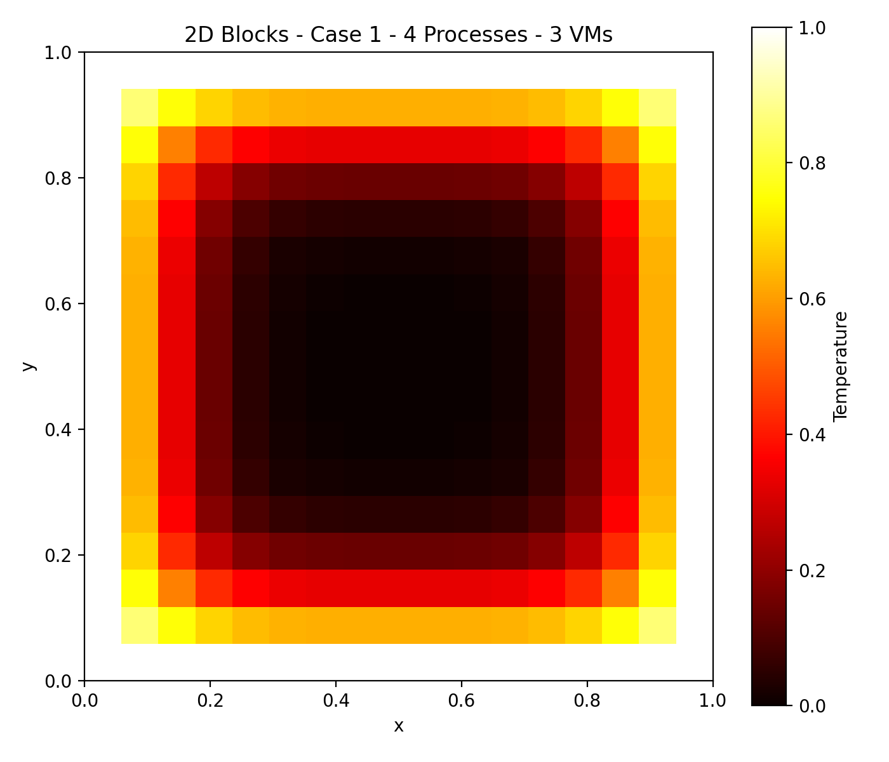
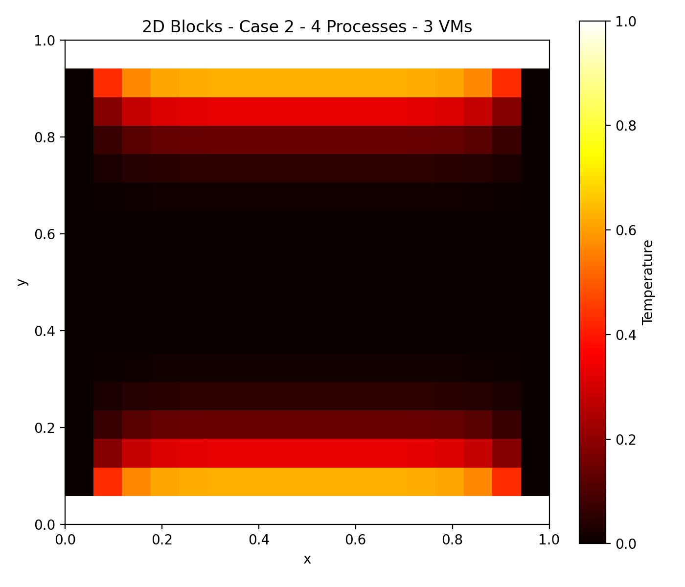
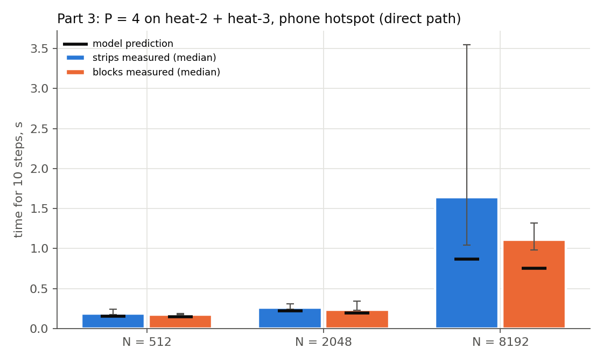
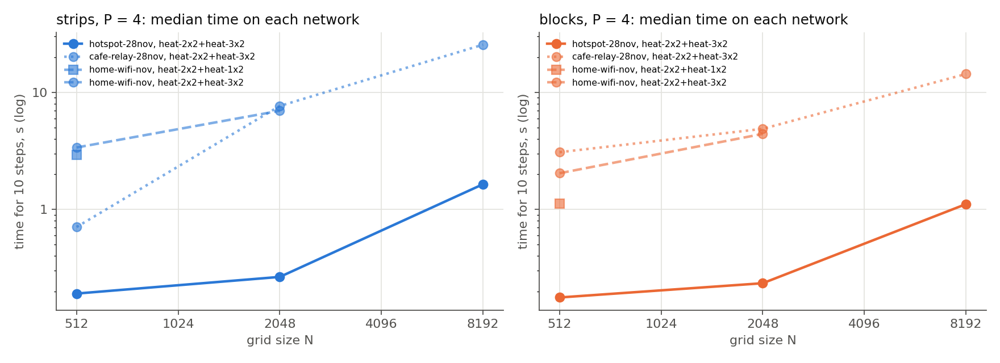

# Part 3 – MPI 2D Block Decomposition

## Objective

Implement a parallel 2D heat diffusion solver using MPI with a two-dimensional block decomposition and compare its correctness and performance with the serial and 1D strip implementations.

## Implementation

The solver uses:

- MPI_Dims_create to determine the process grid dimensions.
- MPI_Cart_create to create a non-periodic Cartesian topology.
- MPI_Cart_shift to identify neighboring processes.
- Balanced distribution of interior grid points.
- Ghost cells on all four sides of each local block.
- MPI_Type_vector for non-contiguous column communication.
- MPI_Sendrecv for halo exchanges.
- MPI_Gatherv for global grid reconstruction.
- MPI_Wtime for computation and communication measurements.

Corner ghost cells are not exchanged because the five-point stencil does not require diagonal neighbors.

### Why corners are not needed

The five-point update of node (i, j) reads only (i, j) and its four edge
neighbours (i±1, j) and (i, j±1). For a node in the corner of a block, those
neighbours lie in the left/right ghost column or the bottom/top ghost row, never
in a corner ghost cell. A stencil that reads diagonal neighbours would need the
corners, for example the nine-point (compact) Laplacian, which uses
(i±1, j±1). With it, the corner values would have to be exchanged too: either
four extra diagonal messages, or by doing the row exchange first and then sending
columns that include the freshly received ghost rows.

## Compilation

```bash
cd part3
make
```

The generated executable is `heat_blocks`.

## Execution

### Local execution

```bash
mpirun -np 4 ./heat_blocks --decomp blocks --case 2 --N 16 --r 0.2 --steps 10
```

### Distributed execution over Tailscale

```bash
mpirun --hostfile hosts_3vm_P4 -np 4 \
  --map-by slot \
  --mca oob_tcp_if_include tailscale0 \
  --mca btl_tcp_if_include tailscale0 \
  --mca btl tcp,self \
  ./heat_blocks --decomp blocks --case 2 \
  --N 16 --r 0.2 --steps 10 \
  --out results/case2.bin
```

Update the hostfiles according to the available machines and their Tailscale addresses.

The executable must be compiled and available at the same path on every participating VM.

## Simulation cases

- Case 1: Four hot boundaries.
- Case 2: Hot top and bottom boundaries and cold lateral boundaries, with hot corners.
- Case V: Analytical verification using a sinusoidal initial temperature and zero boundary temperatures.

## Correctness verification

The automated correctness tests cover:

- Grid sizes N = 8, 9, 10 and 16.
- Process counts P = 1, 2, 3, 4, 6 and 8.
- All three simulation cases.

Result: 72/72 tests passed.

Distributed execution was also verified using multiple VMs. The results were identical to the serial reference in the tested configurations.

To run the automated tests:

```bash
bash tests/check_correctness.sh
```

Compile the Part 1 reference solver before running the tests. Local tests with more processes than available CPU slots use oversubscription and are not performance benchmarks.

## Simulation results

### Case 1



### Case 2



### Case V


These demonstrations use N = 16, P = 4, r = 0.2 and 10 time steps.

## Prediction: strips or blocks? (Task 8.2)

`analysis/predict_strips_vs_blocks.py` computes the prediction for the setup
that was measured: heat-2 + heat-3 on a phone hotspot with a direct Tailscale
path. The network figures come from a ping-pong run on that same network
(`part0/results/raw/heat2_heat3_hotspot.csv`: ts = 6.825 ms, 5.81 MB/s); the
compute cost per point comes from the Part 4 serial baseline. Output:
`results/predictions_strips_vs_blocks.csv`.

- **Simple model** (one interior process, every message on the cross-VM link):
  strips Tcomm = 2(ts + (N+1)tw), blocks Tcomm = 4(ts + (N/√P)tw).
- **Refined model** (slot placement, real block sizes and physical edges,
  same-VM vs cross-VM links, per-VM compute speed; slowest rank per step).
  P = 4 is heat-2 ×2 + heat-3 ×2. P = 8 would be heat-2 ×4 + heat-3 ×4.

| P | N | Simple: strips comm per step (ms) | Simple: blocks comm per step (ms) | Simple predicts | Refined: strips, 10 steps (s) | Refined: blocks, 10 steps (s) | Refined predicts |
| --- | --- | --- | --- | --- | --- | --- | --- |
| 4 | 512 | 15.1 | 28.7 | strips | 0.152 | 0.145 | blocks |
| 4 | 2048 | 19.3 | 32.9 | strips | 0.222 | 0.194 | blocks |
| 4 | 8192 | 36.2 | 49.9 | strips | 0.868 | 0.755 | blocks |
| 8 | 512 | 15.1 | 28.3 | strips | 0.151 | 0.144 | blocks |
| 8 | 2048 | 19.3 | 31.3 | strips | 0.207 | 0.179 | blocks |
| 8 | 8192 | 36.2 | 43.3 | strips | 0.615 | 0.502 | blocks |

The two models disagree because of the network. With ts ≈ 7 ms, latency
dominates. The simple model counts four messages per step for blocks against
two for strips, so it favours strips at every size. The refined model accounts
for placement. In the 2×2 grid only the up/down exchange crosses between the
VMs, and it carries N/2 values; the left/right exchange stays inside a VM. With
strips, the one cross-VM message carries a full row of N+1 values. So blocks
send half as much data over the slow link, and the refined model favours blocks
everywhere, by more as N grows.

## Performance comparison (measured)

Final measurements, 28 November 2026: heat-2 + heat-3 on a phone hotspot, direct
Tailscale path (`tailscale ping` showed `via 172.20.10.x:41641`, 12–24 ms).
Case 2, r = 0.24, 10 time steps, P = 4 with two ranks per VM (slot placement),
TCP only (`btl tcp,self`), no oversubscription, 3 repetitions each, all
18 runs successful. Raw logs: `results/campaign_P4_hotspot/`.

| N | Strips median (s) | Blocks median (s) | Strips / blocks | Refined model: strips / blocks (s) | Measured / model | Measured faster |
| --- | --- | --- | --- | --- | --- | --- |
| 512 | 0.191 (0.178–0.245) | 0.177 (0.174–0.189) | 1.08 | 0.152 / 0.145 | 1.26 / 1.22 | blocks |
| 2048 | 0.266 (0.245–0.310) | 0.235 (0.229–0.345) | 1.13 | 0.222 / 0.194 | 1.20 / 1.21 | blocks |
| 8192 | 1.643 (1.043–3.548) | 1.111 (0.985–1.320) | 1.48 | 0.868 / 0.755 | 1.89 / 1.47 | blocks |



- **Blocks were faster at every grid size, and the gap grows with N** (1.08×,
  1.13×, 1.48×). That matches the refined model, not the simple one.
- **The refined model is accurate on this network.** Measured medians are within
  1.2–1.3× of the prediction for N = 512 and 2048, and within 1.5–1.9× at
  N = 8192. There, one slow strips repetition (3.5 s) widens the spread.
- Communication took 72–97 % of the time: about 97 % at N = 512 and 72–83 % at
  N = 8192.

### Earlier measurements on other networks

The same configurations were also run on two other networks. These results are
kept, but never pooled with the hotspot data:

| Network | Pair | N | Strips median (s) | Blocks median (s) | Runs |
| --- | --- | --- | --- | --- | --- |
| Home Wi-Fi, November (`results/final_benchmarks/`) | heat-2 + heat-3 | 512 | 3.382 | 2.040 | 3 + 3 |
| Home Wi-Fi, November | heat-2 + heat-3 | 2048 | 6.964 | 4.419 | 3 + 3 |
| Coffee shop, 28 Nov (`results/campaign_P4_amer/`) | heat-2 + heat-3 | 512 / 2048 / 8192 | 0.709 / 7.652 / 25.520 | 3.083 / 4.883 / 14.347 | 2 / 2 / 1 each |



Blocks were also faster in both November configurations. However, the November
times were 16–32× above the model, compared with 1.2–1.9× on the hotspot, so
that network performed far below what its ping-pong measurement suggested. On the
coffee shop network, `tailscale status` showed the heat-3 connection
`relay "par"`. Traffic between the two VMs went through Tailscale's relay in
Paris, because the café Wi-Fi used symmetric NAT (`tailscale netcheck`:
`MappingVariesByDestIP: true`, nearest relay London at 71 ms). Measured
throughput fell to 10–220 KB/s. Two N=8192 runs hung, and heat-3 then stopped
answering SSH altogether. A diagnostic run (`part4/results/diagnostics_*`)
confirmed the cause. On the hotspot, the same N=8192 run took 1.1–1.2 s
whether the ranks used one or two vCPUs per VM. So CPU contention is not a
factor; the network path is.

## Benchmark execution

The measurements use the resumable runner from Part 4. It skips finished
repetitions, keeps failed attempts as `*.failed.log`, and re-checks the cluster
after repeated failures:

```bash
cd ~/part3
bash ~/part4/benchmarks/run_campaign.sh ~/part4/benchmarks/queues/part3_P4.txt \
  ~/part4/hosts_amer results/campaign_P4_hotspot 3        # what produced the table above
bash benchmarks/finish_part3.sh p8 HOSTFILE              # P=8, only with 8 real vCPUs
```

Check that the path is direct before benchmarking:
`tailscale ping <peer>` must answer `via <local IP>:41641`, not `via DERP`.
The earlier scripts (`compare_2vm.sh`, `compare_large_ali.sh`) are kept because
they produced `final_benchmarks/` and the failed N=8192 attempts.

## Experimental limitations

- **Why the first N=8192 attempts failed** (`results/benchmark_full_*`, all
  empty logs). `heat_strips` always gathered the full grid to rank 0, even
  without `--out`, and printed its summary only afterwards. At N = 8192 the two
  remote ranks had to send about 268 MB at about 1.75 MB/s. That takes about
  150 s, longer than the 120 s timeout, so each run was killed after the time
  steps but before printing. The old script then stopped, so blocks N = 8192 was
  never started. `heat_strips` now gathers only for `--out` or Case V, as
  `heat_blocks` already did. The timed loop is unchanged, so earlier strips
  timings remain valid. After the change, 36/36 strips and 72/72 blocks
  correctness tests still pass.
- **P = 8 was predicted but not measured.** It needs 8 vCPUs; the VMs have
  2 each (6 in total).
- **Only 10 time steps** per run, to keep runs short on an unreliable network.
  Per-run fixed costs therefore weigh more than they would with 500 steps.
- **heat-3 is faster than heat-2** (Part 4 serial baseline: 0.72 s vs 2.02 s at
  N = 8192). The slowest rank sets the pace, so heat-2 limits every distributed
  run.

## Project structure

```text
part3/
├── src/
│   └── blocks.cpp
├── analysis/
│   └── predict_strips_vs_blocks.py
├── tests/
├── benchmarks/
├── results/
│   ├── campaign_P4_hotspot/      final P=4 measurements (hotspot)
│   ├── campaign_P4_amer/         coffee shop runs (relayed path, incomplete)
│   ├── final_benchmarks/         November runs
│   ├── demo_blocks_case1.png
│   ├── demo_blocks_case2.png
│   ├── demo_blocks_caseV.png
│   ├── demo_verification.txt
│   └── step16_correctness_log.txt
├── Makefile
├── .gitignore
├── README.md
└── MPI hostfiles
```

## Conclusion

The MPI 2D block implementation reproduces the serial result bit for bit
(72/72 tests, plus distributed runs). On a direct network path, blocks beat
strips at P = 4 for N = 512, 2048 and 8192, by 1.08×, 1.13× and 1.48×. The
refined model predicts this; the simple interior-process model, which ignores
placement, predicts the opposite. The model also predicts the absolute times
within a factor of 1.2–1.9. The measurements on relayed and degraded networks
show that the network path matters more than the decomposition: through the
Paris relay, the same runs were 4–29× slower (13–29× for every configuration
except strips at N = 512).
