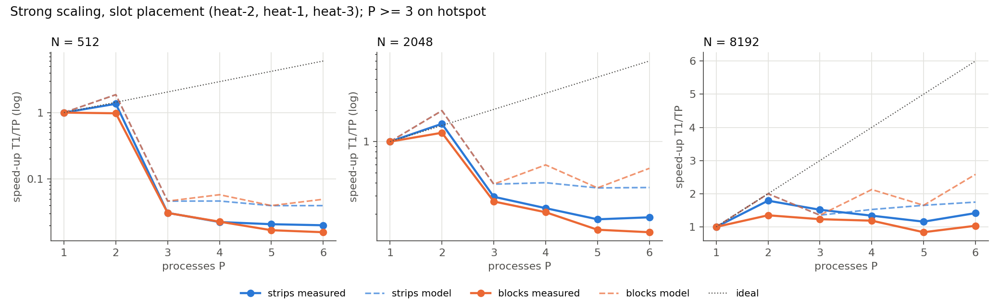
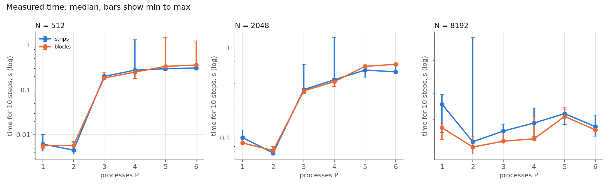
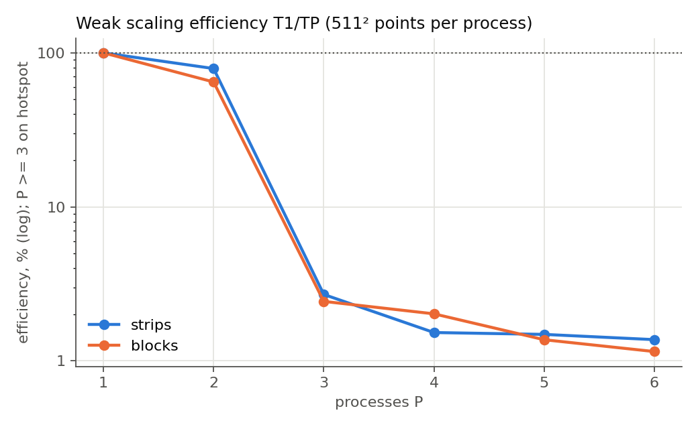
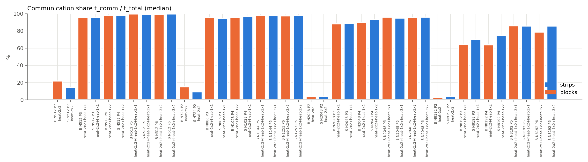
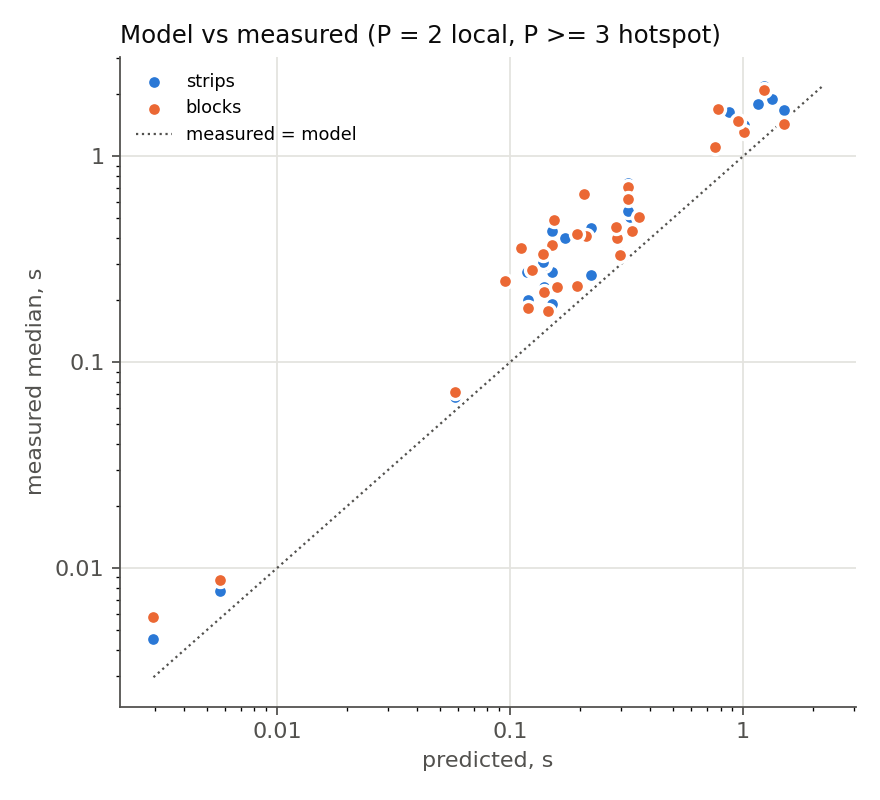
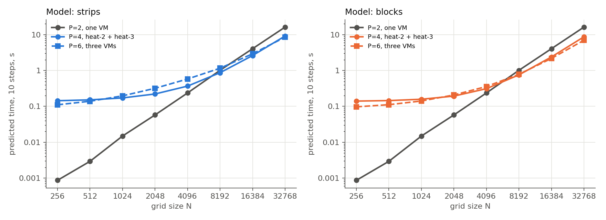

# Part 4 – Performance Measurements and Model Comparison

## Objective

Measure strong and weak scaling of the strips (Part 2) and blocks (Part 3)
solvers on the three VMs, compare every measurement with the performance model,
find the grid size from which distributing over VMs pays off, and quantify how
much of the time is communication.

## Setup

| Item | Value |
| --- | --- |
| VMs | heat-2, heat-1, heat-3: Ubuntu 24.04 in VirtualBox, 2 vCPU / 4 GB each |
| MPI | Open MPI 4.1.6, `--mca btl tcp,self`, `tailscale0` only, no oversubscription |
| Network | 28 Nov 2026, phone hotspot, direct Tailscale paths (`tailscale ping` via `172.20.10.x:41641`) |
| Run | Case 2, r = 0.24, 10 time steps, 3 repetitions, median reported |
| Placement | slot (`hosts_all`: heat-2 ×2, then heat-1 ×2, then heat-3 ×2); node (round-robin) as a comparison |

P = 1 and P = 2 run inside heat-2 only, so no network is involved; those values
come from the November runs (`results/strips_*`, `results/blocks_*`). Every
configuration with P ≥ 3 crosses VMs and was measured on the hotspot
(`results/campaign_*_hotspot/`). The analysis never mixes networks for P ≥ 3.

Serial compute cost per point update (`results/serial_summary.csv`, N = 8192):
heat-2 3.0 ns, heat-1 1.6 ns, heat-3 1.1 ns. heat-2 is the slowest VM and holds
ranks 0 and 1 in every run, so it sets the pace.

## Performance model

`analysis/consolidate.py`, function `predict()`. Per time step and per rank:

- compute = owned points × tc(host), with tc from the serial baseline of that VM;
- communication = Σ over the rank's real neighbours of (ts + m·tw), with ts and
  tw of the actual link: same-VM or cross-VM, from the Part 0 ping-pong;
- a step costs the time of the slowest rank; total = 10 steps.

Network parameters: heat-2 ↔ heat-3 measured on the hotspot (6.83 ms,
5.81 MB/s, `part0/results/raw/heat2_heat3_hotspot.csv`). The hotspot ping-pong
for heat-1's links hung and produced empty files (deleted), so heat-1 links use
the Part 0 values (heat-2 ↔ heat-1 3.51 ms, 1.75 MB/s; heat-1 ↔ heat-3 4.14 ms,
1.47 MB/s).

## Strong scaling (slot placement)

Median time for 10 steps in seconds, speed-up S = T1/TP, communication share in
brackets. Full table: `results/consolidated/strong_scaling.csv`.

| N | Method | P = 1 | P = 2 | P = 3 | P = 4 | P = 5 | P = 6 |
| --- | --- | --- | --- | --- | --- | --- | --- |
| 512 | strips | 0.006 | 0.005 (15 %) | 0.200 (96 %) | 0.275 (98 %) | 0.297 (99 %) | 0.308 (100 %) |
| 512 | blocks | 0.006 | 0.006 (22 %) | 0.184 (96 %) | 0.249 (98 %) | 0.335 (100 %) | 0.359 (99 %) |
| 2048 | strips | 0.101 | 0.068 (4 %) | 0.343 (88 %) | 0.442 (94 %) | 0.566 (95 %) | 0.541 (96 %) |
| 2048 | blocks | 0.088 | 0.072 (4 %) | 0.332 (88 %) | 0.421 (90 %) | 0.622 (96 %) | 0.657 (95 %) |
| 8192 | strips | 2.537 | 1.417 (4 %) | 1.674 (70 %) | 1.896 (75 %) | 2.192 (86 %) | 1.792 (85 %) |
| 8192 | blocks | 1.761 | 1.305 (3 %) | 1.429 (64 %) | 1.483 (64 %) | 2.099 (86 %) | 1.704* (79 %) |

\* one successful run out of five attempts (see limitations); all other cells
have 3 runs.





- **N = 512 and 2048: leaving the VM always loses.** P = 2 inside heat-2 gives
  S = 1.0–1.5. From P = 3, S falls to 0.02–0.03 (N = 512) and 0.13–0.29
  (N = 2048): the step is then 88–100 % communication.
- **N = 8192: distribution helps against one process, not against two.** S over
  P = 1 is 1.0–1.5 for P = 3, 4 and 6 (0.84–1.16 at P = 5), but every distributed
  time on `hosts_all` is still above
  the P = 2 time on heat-2 alone (1.42 s strips, 1.30 s blocks). Communication is
  64–86 % of the time.
- More processes do not help beyond P = 3 or 4. Each extra rank adds a cross-VM
  link with ts ≈ 4–7 ms and only 1.5–5.8 MB/s, while the compute saved per rank
  is small, and heat-2 keeps the same two slowest ranks.

## Weak scaling (slot placement)

511² interior points per process, N = 1 + round(511·√P). Efficiency E = T1/TP.
Table: `results/consolidated/weak_scaling.csv`.

| P | N | Strips median (s) | Strips E | Blocks median (s) | Blocks E | Comm share |
| --- | --- | --- | --- | --- | --- | --- |
| 1 | 512 | 0.006 | 100 % | 0.006 | 100 % | 0 % |
| 2 | 724 | 0.008 | 79 % | 0.009 | 65 % | 9–15 % |
| 3 | 886 | 0.228 | 2.7 % | 0.232 | 2.4 % | 94–96 % |
| 4 | 1023 | 0.403 | 1.5 % | 0.279 | 2.0 % | 96–97 % |
| 5 | 1144 | 0.414 | 1.5 % | 0.411 | 1.4 % | 98 % |
| 6 | 1253 | 0.448 | 1.4 % | 0.490 | 1.1 % | 97–98 % |



Weak scaling holds inside one VM (65–79 % at P = 2) and collapses as soon as a
second VM is involved. With 511² points per process a step computes in about
1 ms, while one cross-VM message costs at least ts ≈ 4–7 ms. The time per step
is therefore set by latency and stays almost flat from P = 4 to P = 6
(0.28–0.49 s), which is the expected weak-scaling shape, but at a level 20–50
times above the compute time.

## Communication share



Median t_comm / t_total: 3–22 % for P = 2 inside heat-2, 88–100 % for every
distributed run at N ≤ 2048, and 64–86 % at N = 8192.

## Model vs measurement



Table: `results/consolidated/model_vs_measured.csv`.

- For the 32 hotspot slot configurations that include heat-1, measured / model
  is 0.96–3.2, median 1.9. The model is optimistic, mostly because heat-1's
  links use the Part 0 ping-pong values and could not be re-measured on the
  hotspot.
- For the heat-2 + heat-3 runs of Part 3, where both ends of the link were
  measured on the same network, measured / model is 1.2–1.3 at N = 512 and
  2048, and 1.5–1.9 at N = 8192.
- The model gets the ranking right where it matters: distributed runs lose at
  N ≤ 2048, the cross-VM latency dominates, and blocks gain the most when only
  their short edges cross the slow link (P = 4 at N = 8192: blocks 1.48 s vs
  strips 1.90 s, model 0.95 s vs 1.33 s).

## Crossover grid size

`results/consolidated/model_crossover.csv`, `plots/model_crossover.png`. The
model compares P = 2 on heat-2 alone with P = 4 on heat-2 + heat-3 (hotspot
parameters) and with P = 6 on all three VMs.

| Method | P = 4 (heat-2 + heat-3) beats P = 2 local from | P = 6 (three VMs) beats P = 2 local from |
| --- | --- | --- |
| strips | N = 8192 (0.87 s vs 1.01 s) | N = 16384 |
| blocks | N = 8192 (0.76 s vs 1.01 s) | N = 8192 (0.78 s vs 1.01 s) |



Measured at N = 8192:

- **Blocks, P = 4 on heat-2 + heat-3 (Part 3): 1.11 s vs 1.30 s for P = 2 local.**
  The crossover is confirmed.
- Strips, P = 4 on heat-2 + heat-3: 1.64 s vs 1.42 s. Not yet; the model margin
  was only 14 %, smaller than the measured / model factor.
- P = 6 on three VMs: 1.70 s (blocks, one run) and 1.79 s (strips). Not yet;
  heat-1's slower links add to the cost.

So distributing over the VMs starts to pay off at about N = 8192 when the
fastest pair (heat-2 + heat-3) is used with blocks, and from N = 16384 otherwise.

## What a faster network would change

`results/consolidated/model_1us_latency.csv` keeps the measured bandwidth and
tc and sets the cross-VM latency to 1 µs. Blocks, P = 6, N = 512: 0.112 s →
0.029 s, still ten times slower than P = 2 local (0.003 s). At N = 8192:
0.78 s → 0.71 s. Latency is the main cost at small N, but the 1.5–5.8 MB/s
Tailscale bandwidth over Wi-Fi alone already keeps small grids from scaling.

## Slot vs node placement

`results/consolidated/slot_vs_node.csv`. Node (round-robin) placement puts
consecutive ranks on different VMs, so every halo exchange crosses the network.

| N | Method | P = 2 slot / node (s) | P = 3 | P = 4 | P = 5 | P = 6 |
| --- | --- | --- | --- | --- | --- | --- |
| 512 | strips | 0.005 / 0.151 | 0.200 / 0.232 | 0.275 / 0.274 | 0.297 / 0.385 | 0.308 / 0.433 |
| 512 | blocks | 0.006 / 0.144 | 0.184 / 0.220 | 0.249 / 0.400 | 0.335 / 0.371 | 0.359 / 0.456 |
| 2048 | strips | 0.068 / 0.323 | 0.343 / 0.455 | 0.442 / 0.510 | 0.566 / 0.744 | 0.541 / – |
| 2048 | blocks | 0.072 / 0.291 | 0.332 / 0.434 | 0.421 / 0.508 | 0.622 / 0.708 | 0.657 / – |

Node placement was slower in 17 of 18 comparable configurations (equal for
strips N = 512, P = 4). At P = 2 the difference is largest: 0.005 s inside
heat-2 against 0.15 s across two VMs. The node values are single runs, and N =
8192 was not reached (see limitations); they show the direction of the effect,
not precise times.

## Benchmark execution

Resumable runner (`benchmarks/run_campaign.sh`, see `benchmarks/RUNBOOK.md`).
It skips finished repetitions, keeps every failed attempt, and records the
network in each configuration's `meta.txt`:

```bash
cd ~/part4
NETWORK=hotspot-28nov bash benchmarks/run_campaign.sh benchmarks/queues/part4_hotspot_strong_slot.txt hosts_all results/campaign_strong_slot_hotspot 3
NETWORK=hotspot-28nov bash benchmarks/run_campaign.sh benchmarks/queues/part4_hotspot_weak_slot.txt   hosts_all results/campaign_weak_slot_hotspot 3
NETWORK=hotspot-28nov bash benchmarks/run_campaign.sh benchmarks/queues/part4_strong_node.txt        hosts_all results/campaign_strong_node_hotspot 3
```

Analysis, from the repository root:

```bash
python part4/analysis/consolidate.py
```

## Limitations

- **Intermittent stalls with all three VMs.** Blocks N = 8192 P = 6 (slot)
  succeeded once and stalled in four attempts; strips N = 2048 P = 6 (node)
  stalled in all three attempts. The stalled logs contain no solver error; the
  only MPI messages ("peer hung up") appear after the cleanup killed the
  ranks. Both configurations use both links
  to heat-1 at the same time, and the same configurations completed in other
  attempts, so this is a network stall, not a solver bug (the solver is also
  verified bit-for-bit in Parts 2 and 3). The attempts are kept in the
  configuration folders (`attempt_*`; interrupted ones lack the `.failed`
  suffix).
- **Node placement is incomplete:** one repetition for N = 512 and 2048,
  P = 2–5 (P = 6 for N = 512), nothing for N = 8192.
- **heat-1 links not re-measured on the hotspot** (the ping-pong hung); the
  model uses the Part 0 values for them.
- **Only 10 time steps per run**, to keep runs short on an unreliable network.
  Fixed per-run costs weigh more than with 500 steps.
- **P = 1 and 2 come from November.** They run inside heat-2 with no network,
  so the network change does not affect them. The strips gather change (Part 2)
  is outside the timed loop.
- **Network variability.** Some medians hide a single slow repetition (for
  example strips N = 512 P = 4: 0.205–1.318 s); the min–max range is in every
  CSV.

## Project structure

```text
part4/
├── analysis/consolidate.py          parsing, medians, model, plots
├── benchmarks/
│   ├── run_campaign.sh              resumable runner
│   ├── queues/                      configuration lists per campaign
│   ├── diagnose.sh                  network / CPU diagnostics (Part 3 café runs)
│   └── RUNBOOK.md
├── results/
│   ├── campaign_strong_slot_hotspot/
│   ├── campaign_weak_slot_hotspot/
│   ├── campaign_strong_node_hotspot/
│   ├── strips_* / blocks_*          November runs (P = 1, 2 used)
│   ├── serial_summary.csv           tc per VM
│   └── consolidated/                all CSV outputs
├── plots/
└── hosts_*                          MPI hostfiles
```

## Conclusion

On this cluster, a time step with P ≥ 3 is 64–100 % communication, because a
cross-VM message over Tailscale on Wi-Fi costs 4–7 ms and moves only
1.5–5.8 MB/s. Strong scaling is therefore negative for N ≤ 2048, and weak
scaling efficiency falls from 65–79 % inside one VM to 1–3 % across VMs. At
N = 8192 the compute finally outweighs the network: blocks on heat-2 + heat-3
(1.11 s) beat the best single-VM run (1.30 s), as the model predicted. Using
more VMs does not help further, because each one adds slow links and the
slowest VM still sets the pace. The model follows the measurements within a
factor of 1.2–1.9 where both ends of each link were measured on the same
network, and within about 2–3 where heat-1's older link values had to be used.
